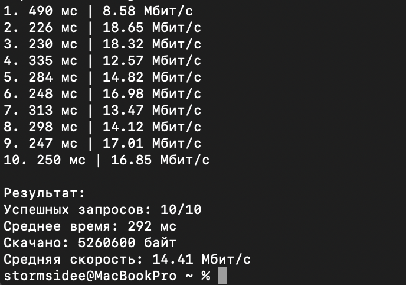

# Speedtest на Node.js

Скрипт делает 10 последовательных запросов к GitHub и измеряет скорость загрузки. Я хорошо знаком с Python, а для тестового задания решил выбрать Node.js, потому что использовал его реже. Скорость вывожу в Мбит/с, как в привычных сервисах проверки скорости интернета.

## Как запустить

1. Скачайте проект и распакуйте его, если скачали архив. Для запуска нужен Node.js.
2. Откройте терминал в папке проекта. В Windows зажмите Shift, щёлкните правой кнопкой мыши по папке и выберите пункт открытия терминала или PowerShell.
3. Выполните `node speedtestTask.js`. Из другой папки укажите полный путь, например `node "/путь/speedtestTask.js"`.
4. Скрипт выведет время и скорость каждого успешного запроса, а затем количество успешных запросов, среднее время, объём скачанных данных и среднюю скорость в Мбит/с.

